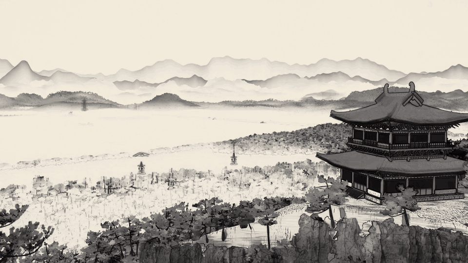
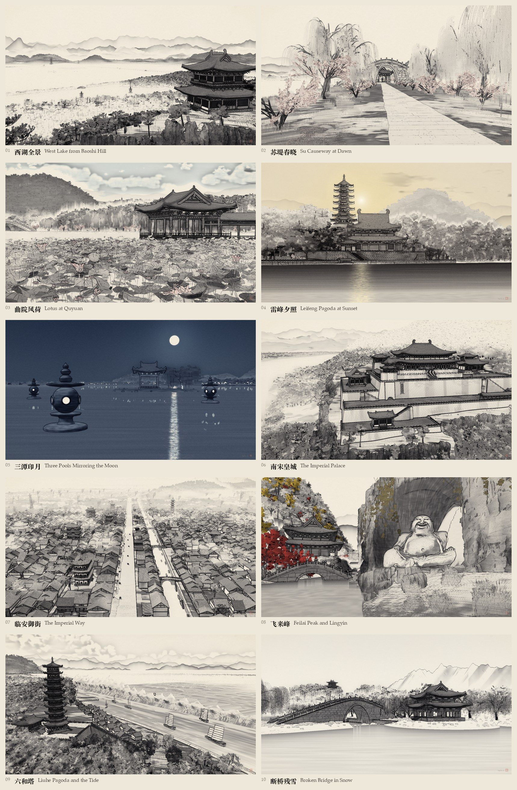

# 临安 Lin'an

Southern Song Hangzhou (南宋临安) and West Lake as a world you can walk through, painted in Chinese ink (纯水墨).
It is built entirely in code with three.js and has no external assets: every mesh, brush stroke and texture is
generated procedurally. There are no downloaded models, scans, textures, HDRIs or fonts. The engine is forked from
[Athenaion](https://github.com/Leonxlnx/athenaion).





**Walk it in your browser: https://linan.lapla.si** (desktop Chrome, Edge or Safari; about 30 s to load)

Video: [tour](media/tour.mp4) · [walk](media/walk.mp4)

## What's in it

- **A 《营造法式》 architecture generator.** Every timber building is built by the rules of the Song building manual
  (李诫, 1103). Sizes are measured in 材分 (eight grades of 材, where 1 材 = 15 分). Roof profiles follow 举折, and
  the eave overhang (出檐) and corner lift follow the manual. Bracket sets (斗拱 / 铺作) are built member by member, and
  the platforms, 勾闌 balustrades and Song paint schemes follow it too. `src/yingzao/fashi.js` cites the 卷 and
  section behind every number.
- **Pagodas:** 雷峰塔, 六和塔, 保俶塔, the 三潭 stone lanterns, and city and hill pagodas.
- **The palace and the city.** The palace stands on walled terraces (城台) on 凤凰山. The city of Lin'an has 御街,
  the 市河 canal, shop rows and walled courtyards, stone bridges, boats and kitchen smoke.
- **飞来峰.** A limestone cliff with the 布袋弥勒 carved in its niche, sculpted as signed distance fields and meshed.
- **Water.** West Lake as a still mirror, the 钱塘江 and the 钱塘潮 tidal bore breaking below 六和塔.
- **Seasons and times:** spring dawn, summer noon, sunset, moonlit night, autumn and winter snow. The plants include
  willows, peach, lotus, camphor, pines, maples, ginkgo and tea.
- **Countryside.** Paddy fields framed by bunds, terraced paddies on the hill feet, mulberry plots, 龙井 tea in rows
  along the contours, and hamlets with threshing floors and shrines.
- **The ink painter** (`src/ink/`). Every material also writes a G-buffer, and a painter pass turns it into a
  painting. It draws brush outlines (勾), texture strokes (皴) and graded washes (染), and leaves bare paper (留白)
  for mist, water and sky. Strokes are anchored to the world, so the painting holds still while you move. There are
  three styles: 纯水墨 (`mo`), 浅绛 (`qj`) and 青绿 (`ql`).
- **The explorable mode.** The terrain streams in from workers, and you can walk or fly anywhere. There are ten
  viewpoints, and at each one the view settles into the same painting as the offline still. There are six times of day
  and seasons, and touch controls for phones.
- **An offline renderer** (from Athenaion) with jittered accumulation (anti-aliasing, soft shadows, motion blur), tone
  mapping, local tone mapping, bloom and grading, for stills up to 4K and video.

About 32,000 lines of JavaScript in about 150 files.

## Controls

| | |
|---|---|
| WASD or arrow keys | walk |
| mouse (click the picture first, Esc frees the mouse) | look around |
| Shift | run |
| F | switch between flying and walking |
| Space / E, Q / C | up, down (flying) |
| 1–9, 0 | jump to a viewpoint (0 is the tenth) |
| T | next time of day or season |
| M or Tab | menu: places, times, walk or fly |
| P | print the camera position (console and clipboard) |
| phone | drag on the left to walk, drag on the right to look; 升 / 降 buttons while flying |

URL options: `?at=4` starts at viewpoint 4. `?time=10` starts in a given time of day or season; the numbers are the
shot looks in `src/world/looks.js`: 2 spring dawn, 3 summer noon, 4 sunset, 5 moonlit night, 8 autumn, 10 winter
snow. `?look=photo` shows the photographic render instead of ink, and `?debug=1` shows the frame rate.

## How to run

You need Node.js 22 or newer and a desktop browser with WebGL 2 on a strong GPU. The world is heavy: the tab holds
about 0.5–0.7 GB of JavaScript heap and the GPU about 2 GB of geometry (see [the roadmap](docs/ROADMAP.md)). It was
developed in Chrome on an Apple M1 Max.

```bash
npm install
node tools/serve.mjs          # or: node tools/serve.mjs 8090 for another port
```

Then open http://localhost:8080/. The first load takes a while; the loading screen shows its progress.

The heavy rock geometry (the 飞来峰 cliff, the 布袋 and the rock sites) is not committed. Without it, the browser
meshes it at load, which adds about a minute to every load, and the console shows a 404 for each missing file in
`generated/` (harmless). To bake it once (git-ignored):

```bash
node tools/bake.mjs karst
node tools/bake.mjs rocks
```

Each bake writes `generated/<name>.bin` (floats as built, ~180 MB in all: the offline stills read these),
`generated/<name>.geo` (quantised and gzipped, ~42 MB: the explorable page downloads these, the ones near the walker
first) and `generated/manifest.json`. `node tools/bake.mjs compact` makes the `.geo` files and the manifest from
existing `.bin` bakes. Bake again after changing a generator; the bake names carry a version, and a missing bake falls
back to building.

## Putting it on the web

```bash
node tools/build-site.mjs        # → dist/ (bake first: it takes the compact bakes of generated/manifest.json)
node tools/serve.mjs 8090 dist   # check it, or any static server
```

`dist/` is a static site of about 45 MiB with no file over 6 MiB: `index.html`, `src/`, only the three.js files the page
imports (the import map points inside `dist/`), the compact bakes and a `_headers` file for Cloudflare Pages or Netlify
(a year's cache for three.js and the bakes, whose paths carry versions; revalidation for the page). About 6 MB is
fetched before the first frame; the rocks and the cliff follow as the walker comes near.

## Rendering stills and video

The render tools drive headless Chrome on the GPU, each run in a fresh throwaway profile. They look for Chrome or
Chromium in `/Applications`; elsewhere, set `CHROME=/path/to/chrome`, and on a machine without Metal set `ANGLE=gl`.
The compare images and the video also need ffmpeg on the PATH.

```bash
# one ink still (1664 × 928) → out/shot2.png, plus out/shot2_cmp.png (the photographic reference beside it)
node tools/render.mjs --shot 2 --quality preview --params "look=ink&inkStyle=mo"

# all ten ink stills in 4K at high quality
node tools/render.mjs --shot all --quality high --spp 12 --w 3840 --h 2160 --params "look=ink&inkStyle=mo" --outdir out/ink/mo

# the photographic render of a shot (no look parameter)
node tools/render.mjs --shot 4 --quality high --spp 12

# one module alone in a neutral test scene → out/test_yingzao_v0.png
node tools/render.mjs --test yingzao --view 0

# the tour video (src/video/sequence.js) in ink, frame by frame and resumable, then encoded → out/video/
node tools/render-video.mjs --w 1920 --h 1080 --spp 12 --quality high
node tools/render-video.mjs --w 640 --h 360 --spp 2 --paints 1 --out out/video_preview   # a fast motion preview
node tools/render-video.mjs --segments 2 --frames 0,1,2 --no-encode --out out/video_check  # only some frames

# the walk video: the explorable page itself, captured frame by frame at 1440 × 900 → out/walk/walk.mp4
node tools/capture-walk.mjs

# the README teaser: four moments of media/tour.mp4 as a 960 px GIF → media/teaser.gif
node tools/make-teaser.mjs
```

`render.mjs` and `render-video.mjs` stamp the watermark into their frames; `--wm 0` leaves it out (`?wm=0` hides it in
the page, for development). `render-video.mjs` also takes `--params "look=photo"` (the photographic render with motion
blur instead of ink), `--paints N` (each ink frame is the mean of N paintings seen through sub-pixel offsets of the
camera, default 8, which keeps the strokes over leaves and willow strands from flickering as the camera moves),
`--time-scale K` (how fast wind, water and clouds move; 0 freezes them), `--crf N` and `--name file.mp4`.
`capture-walk.mjs` drives the page with real key presses on a virtual clock of 1/30 s per frame, so walking speeds,
fades and titles keep their real pace however slowly the frames are captured; its script is the `TIMELINE` at the top
of the file.

`docs/CONTRACT.md` lists the other tools: a persistent render session (`tools/session.mjs` and `tools/snap.mjs`), a
headless session for the explorable world (`tools/explore-session.mjs`) with frame-rate, walking-screenshot and
still-matching scripts, colour statistics against a reference (`tools/colorstats.mjs`), crops and contact sheets.

## References

The world was built to match two sets of ten images, one per viewpoint. Both are in [`refs/`](refs):

- `refs/ref01.jpg` … `ref10.jpg`: photographic references for composition, scale, light and colour.
- `refs/ink01.jpg` … `ink10.jpg`: ink-painting targets for the 纯水墨 look.

**These images are AI-generated**, made with Qwen-Image 2.1 (Apache-2.0) from
the prompts in `refs/shots.json`, `refs/ink-probe.json` and `refs/ink-refs-mo.json`, by `tools/refs.py` on a ComfyUI
server. The renders are only compared against them, side by side and with colour statistics. Nothing in the world is
made from them: they are never used as textures and never loaded by the page. Where a reference departs from history
or geography, `docs/ART_BIBLE.md` §8 says what was built instead.

## How it was made

It was built with Claude Code, in the spirit of Athenaion. The engine (render harness, atmosphere, sky, water,
accumulation) came from Athenaion. The Chinese world was then written module by module on top of it: the 营造法式
generator, terrain and water, the city, the karst and sculpture, vegetation, the ink painter and the explorable world.
Each module was rendered and checked against the references with side-by-side comparisons and colour statistics. The
design documents are in [`docs/`](docs): the art bible, the composition plan per camera and the engineering contract.

## Performance notes and known gaps

The explorable world is heavy on the GPU: about 2 GB of geometry once the walker has been everywhere, and a frame rate
in the 30s at the palace and on 御街 at 1440 × 900 (the live painting's resolution adapts when frames run slow). The
JS heap stays at about 0.5–0.7 GB, and the vegetation and terrain stream in slices without long frames.
[`docs/ROADMAP.md`](docs/ROADMAP.md) has the measurements, what is left, and the remaining differences from the targets.

## Credits

- [Athenaion](https://github.com/Leonxlnx/athenaion) by Leon Lin (MIT): the engine this world is built on.
  [`NOTICE`](NOTICE) lists the files that derive from it, and its licence is in
  [`THIRD_PARTY/athenaion-LICENSE`](THIRD_PARTY/athenaion-LICENSE).
- [three.js](https://threejs.org) (MIT).
- 《营造法式》 (李诫, 1103), read on Wikisource (the 四库全书 edition and a punctuated edition).

## Licence

MIT. See [`LICENSE`](LICENSE).

---

## 中文简介

南宋临安与西湖，一座可以走进去的水墨世界。全部用 three.js 代码生成：每一个模型、每一笔墨、每一张纹理都由程序写出，不用任何外部素材（没有现成模型、扫描、贴图或字体）。引擎来自 [Athenaion](https://github.com/Leonxlnx/athenaion)（MIT）。

- **营造法式生成器**：按《营造法式》（李诫，1103）的规则造木构建筑：以材分为模数，举折定屋面曲线，出檐与翼角起翘，斗拱铺作逐件生成；每个数字都注明出自哪一卷。
- **塔、宫、城**：雷峰塔、六和塔、保俶塔、三潭石塔；凤凰山上城台层叠的南宋皇城；御街、市河、店铺、院墙、石桥、船与炊烟。
- **飞来峰**：石灰岩崖壁上的布袋弥勒造像，用 SDF 雕刻。
- **钱塘潮、四季与田园**：春晓、夏午、夕照、月夜、秋、冬雪；水田、梯田、桑园、龙井茶垄与村落。
- **水墨画师**：勾、皴、染、留白；笔触固定在世界里，走动时画面不会“游”。纯水墨、浅绛、青绿三种画风。
- **漫游模式**：步行或飞行，十个名胜视角，六种时令，手机可触控操作。

运行：`npm install`，然后 `node tools/serve.mjs`，打开 http://localhost:8080/ 。发布为静态网站：`node tools/build-site.mjs` 生成 `dist/`。操作：WASD 行走，鼠标环顾，F 飞行，1–9 和 0 跳到名胜，T 切换时令，M 打开菜单。

`refs/` 里的参考图（写实十张、水墨十张）都是 AI 生成的（Qwen-Image 2.1），只用来对照，从不作为贴图。已知问题和性能情况见 [docs/ROADMAP.md](docs/ROADMAP.md)。MIT 许可。
